
<b>BACKGROUND &amp; INTRODUCTION</b>

  Reeyan Afzal Khan holds a bachelor's degree in Computer Science from Kohat University of Science &amp; Technology (KUST) and a Master's degree in Information Technology from Universiti Teknologi PETRONAS (UTP). His technical expertise is backed by professional certifications from Google, Meta, and IBM. Additionally, he is a fluent speaker of Mandarin Chinese, supported by language certifications from Peking University and Shanghai Jiao Tong University, and holds official proficiency credentials in both IELTS (Band 7.0) and HSK Level 4.

  Bringing international teaching experience from his tenure as a Graduate Research Assistant (GRA), Reeyan has mentored students through lab sessions and Final Year Projects (FYPs) and taught courses such as Algorithms &amp; Data Structures, Data Science, Machine Learning, and Enterprise Resource Planning.

  Driven by a passion for collaboration, innovation, and continuous growth, Reeyan actively applies his technical and leadership skills to create a positive impact. Previously, he also served as a Vice President (Inbound) of the DC-PGSC at UTP, where he assisted in the coordination of hybrid workshops and resolved key logistical challenges to strengthen support for the postgraduate computing community.

<!--
  Generated from Typst sources kept outside this repository; edits made here
  are overwritten by the next build.
-->

<b>CONNECT WITH ME</b>

<table align="center">
  <tr>
    <td align="center">
      
    </td>
    <td align="center">
      
    </td>
    <td align="center">
      
    </td>
  </tr>
</table>

<b>PROFILE &amp; PORTFOLIO</b>

<table align="center">
  <tr>
    <th align="center">freeCodeCamp</th>
    <th align="center">LeetCode</th>
    <th align="center">HackerRank</th>
    <th align="center">Credly</th>
    <th align="center">ORCID</th>
    <th align="center">YouTube</th>
  </tr>
  <tr>
    <td align="center">
      
    </td>
    <td align="center">
      
    </td>
    <td align="center">
      
    </td>
    <td align="center">
      <a href="https://www.credly.com/users/reeyan-afzal-khan">
        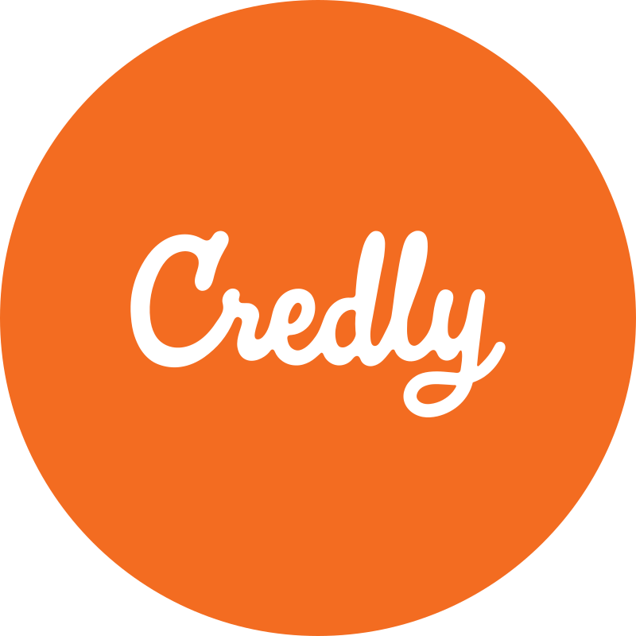
      </a>
    </td>
    <td align="center">
      
    </td>
    <td align="center">
      
    </td>
  </tr>
</table>

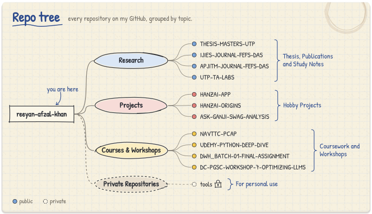

<!-- ======================= OPEN NOTEBOOK: PUBLIC REPOSITORIES ======================= -->

  <a href="https://github.com/reeyan-afzal-khan/THESIS-MASTERS-UTP">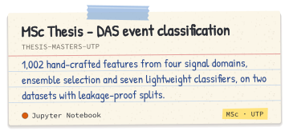</a>
  
  
  

  <a href="https://github.com/reeyan-afzal-khan/HANZAI-APP">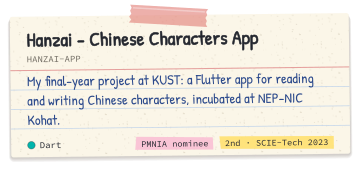</a>
  
  

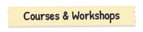

  <a href="https://github.com/reeyan-afzal-khan/NAVTTC-PCAP">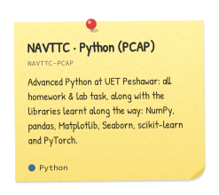</a>
  
  
  

<!-- ======================= LOCKED DRAWER: PRIVATE REPOSITORIES ======================= -->

If you want to discuss, ask me on <a href="https://www.linkedin.com/in/reeyan-afzal-khan/">LinkedIn</a>.

<!-- ======================= DOCUMENTS ======================= -->

<table align="center">
  <tbody><tr><td align="left" valign="top" width="845">
     
    <b>EXPERIENCE</b> 
    
    <b>Universiti Teknologi PETRONAS</b> 
    Perak, Malaysia 
    <a name="experience-1-utp-2-tile"><picture><source media="(max-width: 767px)" srcset="assets/drawings/documents/experience-1-utp-2-phone.svg"/></picture></a>
    <b>Vice President (Inbound), DC-PGSC</b> 
     
    <a href="assets/documents/Reeyan-Afzal-Experience-Letter-UTP-DC-PGSC.jpeg"><picture><source media="(prefers-color-scheme: dark)" srcset="assets/drawings/documents/tag-experience-letter-dark.svg"/><source media="(prefers-color-scheme: light)" srcset="assets/drawings/documents/tag-experience-letter-light.svg"/></picture></a> 
    <a name="experience-1-utp-3-tile"><picture><source media="(max-width: 767px)" srcset="assets/drawings/documents/experience-1-utp-3-phone.svg"/></picture></a>
    <b>Graduate Research Assistant (GRA)</b> 
     
    <a href="assets/documents/Reeyan-Afzal-Experience-Letter-UTP-GRA.jpeg"><picture><source media="(prefers-color-scheme: dark)" srcset="assets/drawings/documents/tag-experience-letter-dark.svg"/><source media="(prefers-color-scheme: light)" srcset="assets/drawings/documents/tag-experience-letter-light.svg"/></picture></a> 
     
    <a name="experience-2-nic-1-tile"><picture><source media="(max-width: 767px)" srcset="assets/drawings/documents/experience-2-nic-phone.svg"/></picture></a>
    <b>Founder and app developer, Hanzai</b> 
    NEP-NIC (PITB), Kohat 
     
    <a href="assets/documents/Reeyan-Afzal-Experience-Letter-NEP-NIC.jpeg"><picture><source media="(prefers-color-scheme: dark)" srcset="assets/drawings/documents/tag-experience-letter-dark.svg"/><source media="(prefers-color-scheme: light)" srcset="assets/drawings/documents/tag-experience-letter-light.svg"/></picture></a> 
    
  </td></tr></tbody>
</table>
<table align="center">
  <tbody><tr><td align="left" valign="top" width="845">
     
    <b>EDUCATION</b> 
    
    <b>Universiti Teknologi PETRONAS</b> 
    MSc Information Technology 
    <a href="assets/documents/Reeyan-Afzal-MSc-Degree.jpeg"><picture><source media="(prefers-color-scheme: dark)" srcset="assets/drawings/documents/tag-degree-dark.svg"/><source media="(prefers-color-scheme: light)" srcset="assets/drawings/documents/tag-degree-light.svg"/></picture></a>
    <a href="assets/documents/Reeyan-Afzal-MSc-Transcript.jpeg"><picture><source media="(prefers-color-scheme: dark)" srcset="assets/drawings/documents/tag-transcript-dark.svg"/><source media="(prefers-color-scheme: light)" srcset="assets/drawings/documents/tag-transcript-light.svg"/></picture></a> 
     
    <a name="education-2-kust-1-tile"><picture><source media="(max-width: 767px)" srcset="assets/drawings/documents/education-2-kust-phone.svg"/></picture></a>
    <b>Kohat University of Science and Technology</b> 
    BS Computer Science 
    <a href="assets/documents/Reeyan-Afzal-BS-Degree.jpeg"><picture><source media="(prefers-color-scheme: dark)" srcset="assets/drawings/documents/tag-degree-dark.svg"/><source media="(prefers-color-scheme: light)" srcset="assets/drawings/documents/tag-degree-light.svg"/></picture></a>
    <a href="assets/documents/Reeyan-Afzal-BS-Transcript.jpeg"><picture><source media="(prefers-color-scheme: dark)" srcset="assets/drawings/documents/tag-transcript-dark.svg"/><source media="(prefers-color-scheme: light)" srcset="assets/drawings/documents/tag-transcript-light.svg"/></picture></a> 
    
  </td></tr></tbody>
</table>
<table align="center">
  <tbody><tr><td align="left" valign="top" width="845">
     
    <b>LANGUAGE PROFICIENCY</b> 
    
    <b>IELTS Academic, band 7.0 (C1)</b> 
    English 
     
    <a href="assets/documents/Reeyan-Afzal-Certificate-IELTS-2023.jpeg"><picture><source media="(prefers-color-scheme: dark)" srcset="assets/drawings/documents/tag-certificate-dark.svg"/><source media="(prefers-color-scheme: light)" srcset="assets/drawings/documents/tag-certificate-light.svg"/></picture></a> 
     
    <a name="language-2-hsk-1-tile">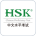</a>
    <b>HSK 4 and HSKK 2</b> 
    Chinese (Mandarin) 
     
    <a href="assets/documents/Reeyan-Afzal-Certificate-HSK4-2024.jpeg"><picture><source media="(prefers-color-scheme: dark)" srcset="assets/drawings/documents/tag-certificate-dark.svg"/><source media="(prefers-color-scheme: light)" srcset="assets/drawings/documents/tag-certificate-light.svg"/></picture></a> 
    
  </td></tr></tbody>
</table>

<!-- ======================= SKILLS & TOOLS ======================= -->

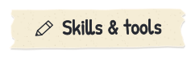

  
  
  
  <a name="skills-web-app-development">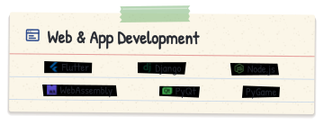</a>
  <a name="skills-databases-big-data">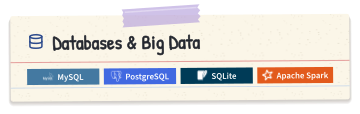</a>
  <a name="skills-testing-apis">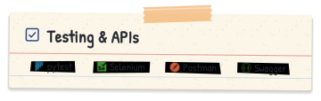</a>
  <a name="skills-developer-tools">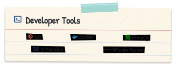</a>
  

