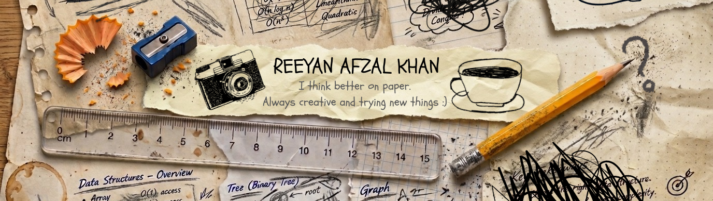
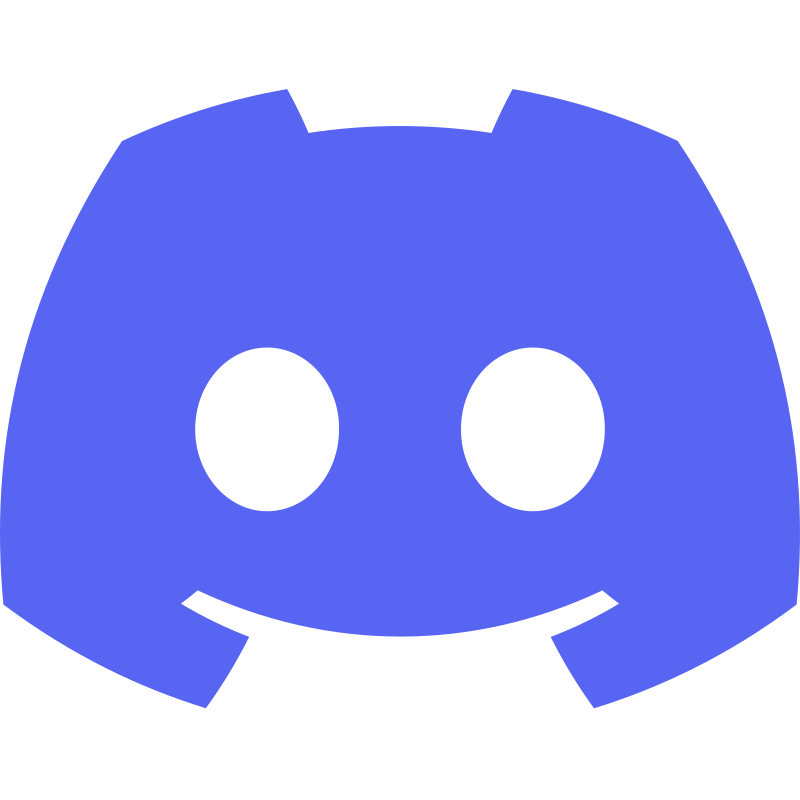
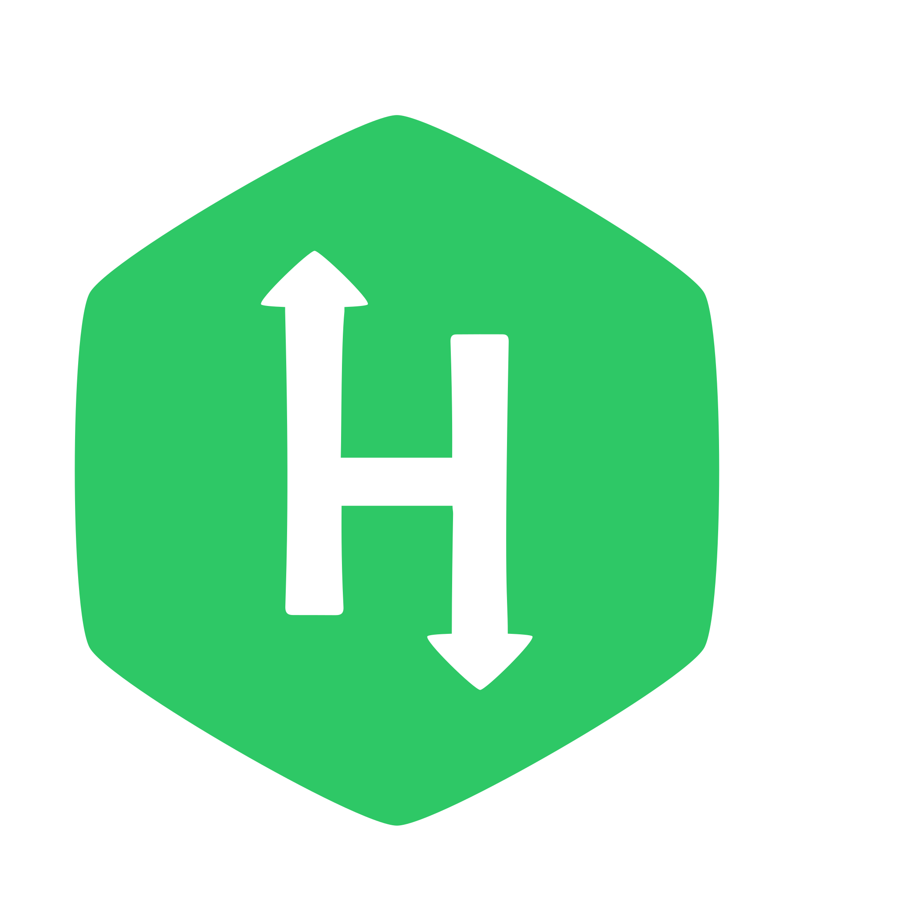
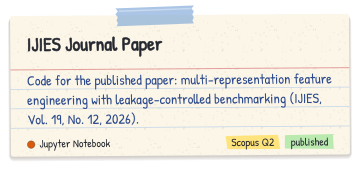
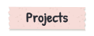
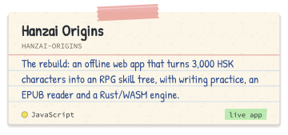
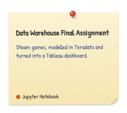
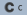

<!--
  Generated from Typst sources kept outside this repository; edits made here
  are overwritten by the next build.
-->

<h4 align="center">CONNECT WITH ME</h4>
<table align="center">
  <tr>
    <td align="center">
      
    </td>
    <td align="center">
      
    </td>
    <td align="center">
      
    </td>
  </tr>
</table>

<h4 align="center">PROFILE &amp; PORTFOLIO</h4>
<table align="center">
  <tr>
    <th align="center">freeCodeCamp</th>
    <th align="center">LeetCode</th>
    <th align="center">HackerRank</th>
    <th align="center">Credly</th>
    <th align="center">ORCID</th>
    <th align="center">YouTube</th>
  </tr>
  <tr>
    <td align="center">
      
    </td>
    <td align="center">
      
    </td>
    <td align="center">
      
    </td>
    <td align="center">
      
    </td>
    <td align="center">
      
    </td>
    <td align="center">
      
    </td>
  </tr>
</table>

<h3 align="center">Hi, I'm Reeyan (瑞琰)</h3>

  Reeyan Afzal Khan holds a bachelor's degree in Computer Science from Kohat University of Science &amp; Technology and a Master's degree in Information Technology from Universiti Teknologi PETRONAS (UTP). His technical expertise is backed by professional certifications from Google, Meta, and IBM. Additionally, he is a fluent speaker of Mandarin Chinese, supported by language certifications from Peking University and Shanghai Jiao Tong University, and holds official proficiency credentials in both IELTS (Band 7.0) and HSK Level 4.

  Bringing international teaching experience from his tenure as a Graduate Research Assistant (GRA), Reeyan has mentored students through lab sessions and Final Year Projects (FYPs) and taught courses such as Algorithms &amp; Data Structures, Data Science, Machine Learning, and Enterprise Resource Planning.

  Driven by a passion for collaboration, innovation, and continuous growth, Reeyan actively applies his technical and leadership skills to create a positive impact. Previously, he also served as a Vice President (Inbound) of the DC-PGSC at UTP, where he assisted in the coordination of hybrid workshops and resolved key logistical challenges to strengthen support for the postgraduate computing community.

<!-- ======================= OPEN NOTEBOOK: PUBLIC REPOSITORIES ======================= -->

  
  
  
  

  
  
  

  
  
  
  

<!-- ======================= LOCKED DRAWER: PRIVATE REPOSITORIES ======================= -->

If you want to discuss, ask me on <a href="https://www.linkedin.com/in/reeyan-afzal-khan/">LinkedIn</a>.

<!-- ======================= DOCUMENTS ======================= -->

  
<b>Certificates and experience letters for my CV</b>

   
<table align="center">
  <tbody><tr><th align="left" valign="top" width="818"> Experience</th></tr></tbody>
  <tbody><tr><td align="left" valign="top">
    
    <b>Universiti Teknologi PETRONAS</b> 
    Perak, Malaysia 
    <b>Vice President (Inbound), DC-PGSC</b> 
    Jan 2024 to present 
     <a href="assets/documents/Reeyan-Afzal-Experience-Letter-UTP-DC-PGSC.jpeg">Experience letter</a> 
     
    <b>Graduate Research Assistant (GRA)</b> 
    Jan 2024 to present 
     <a href="assets/documents/Reeyan-Afzal-Experience-Letter-UTP-GRA.jpeg">Experience letter</a>
  </td></tr></tbody>
  <tbody><tr><td align="left" valign="top">
    
    <b>Founder and app developer, Hanzai</b> 
    NEP-NIC (PITB), Kohat 
    Sep 2022 to Feb 2023 
     <a href="assets/documents/Reeyan-Afzal-Experience-Letter-NEP-NIC.jpeg">Experience letter</a>
  </td></tr></tbody>
  <tbody><tr><th align="left" valign="top"> Education</th></tr></tbody>
  <tbody><tr><td align="left" valign="top">
    
    <b>Universiti Teknologi PETRONAS</b> 
    MSc Information Technology 
     <a href="assets/documents/Reeyan-Afzal-MSc-Degree.jpeg">Degree</a> · <a href="assets/documents/Reeyan-Afzal-MSc-Transcript.jpeg">Transcript</a>
  </td></tr></tbody>
  <tbody><tr><td align="left" valign="top">
    
    <b>Kohat University of Science and Technology</b> 
    BS Computer Science 
     <a href="assets/documents/Reeyan-Afzal-BS-Degree.jpeg">Degree</a> · <a href="assets/documents/Reeyan-Afzal-BS-Transcript.jpeg">Transcript</a>
  </td></tr></tbody>
  <tbody><tr><th align="left" valign="top"> Language Proficiency</th></tr></tbody>
  <tbody><tr><td align="left" valign="top">
    
    <b>IELTS Academic, band 7.0 (C1)</b> 
    English 
    2023 to 2025 
     <a href="assets/documents/Reeyan-Afzal-Certificate-IELTS-2023.jpeg">Certificate</a>
  </td></tr></tbody>
  <tbody><tr><td align="left" valign="top">
    
    <b>HSK 4 and HSKK 2</b> 
    Chinese (Mandarin) 
    2024 to 2026 
     <a href="assets/documents/Reeyan-Afzal-Certificate-HSK4-2024.jpeg">Certificate</a>
  </td></tr></tbody>
</table>

<!-- ======================= SKILLS & TOOLS ======================= -->

<table align="center">
  <tbody><tr><td align="left" valign="top" width="818">
    
    <b>Research &amp; ML</b> 
    
    
    
    
    
    
    
    
  </td></tr></tbody>
  <tbody><tr><td align="left" valign="top">
    
    <b>Edge AI</b> 
    
    
  </td></tr></tbody>
  <tbody><tr><td align="left" valign="top">
    
    <b>Speech &amp; NLP</b> 
    
    
  </td></tr></tbody>
  <tbody><tr><td align="left" valign="top">
    
    <b>Apps &amp; web</b> 
    
    
    
    
    
    
  </td></tr></tbody>
  <tbody><tr><td align="left" valign="top">
    
    <b>Data &amp; BI</b> 
    
    
    
    
    
    
    
  </td></tr></tbody>
  <tbody><tr><td align="left" valign="top">
    
    <b>Python frameworks</b> 
    
    
    
    
    
    
  </td></tr></tbody>
  <tbody><tr><td align="left" valign="top">
    
    <b>Teaching</b> 
    
    
    
    
    
  </td></tr></tbody>
  <tbody><tr><td align="left" valign="top">
    
    <b>Tooling &amp; platforms</b> 
    
    
    
    
     
    
    
    
    
    
  </td></tr></tbody>
</table>

