
<a name="introduction"><picture><source media="(max-width: 767px)" srcset="https://raw.githubusercontent.com/reeyan-afzal-khan/reeyan-afzal-khan/main/assets/drawings/intro-narrow.svg"/></picture></a>

<!--
  Generated from Typst sources kept outside this repository; edits made here
  are overwritten by the next build.
-->

<a name="links-break-1"><picture><source media="(max-width: 1279px)" srcset="https://raw.githubusercontent.com/reeyan-afzal-khan/reeyan-afzal-khan/main/assets/drawings/links/break.svg"/></picture></a>

<a href="https://scholar.google.com/citations?user=UGLsNIsAAAAJ&hl=en">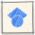</a>
<a name="links-gap-1"><picture><source media="(max-width: 1279px)" srcset="https://raw.githubusercontent.com/reeyan-afzal-khan/reeyan-afzal-khan/main/assets/drawings/links/break.svg"/></picture></a>

<a name="links-break-2"><picture><source media="(max-width: 1279px)" srcset="https://raw.githubusercontent.com/reeyan-afzal-khan/reeyan-afzal-khan/main/assets/drawings/links/break.svg"/></picture></a>
<a href="https://www.freecodecamp.org/reeyan-afzal-khan">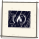</a>

<!-- ======================= OPEN NOTEBOOK: PUBLIC REPOSITORIES ======================= -->

  
  
  <a href="https://github.com/reeyan-afzal-khan/APJITM-JOURNAL-FEFS-DAS">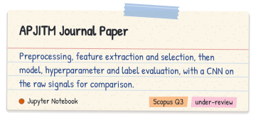</a>
  <a href="https://github.com/reeyan-afzal-khan/UTP-TA-LABS">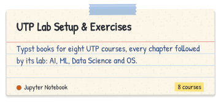</a>

  
  
  <a href="https://github.com/reeyan-afzal-khan/ASK-GANJI-SWAG-ANALYSIS">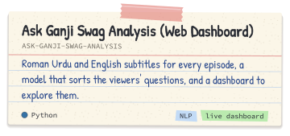</a>

  
  <a href="https://github.com/reeyan-afzal-khan/UDEMY-PYTHON-DEEP-DIVE">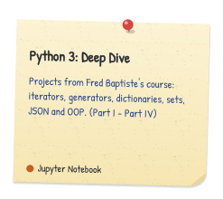</a>
  
  <a href="https://github.com/reeyan-afzal-khan/DC-PGSC-WORKSHOP-7-OPTIMIZING-LLMS">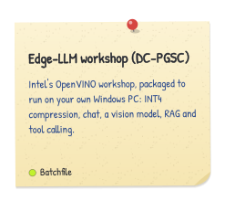</a>

<!-- ======================= LOCKED DRAWER: PRIVATE REPOSITORIES ======================= -->

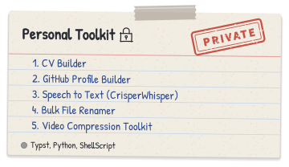

<!-- ======================= DOCUMENTS ======================= -->

     
    
    <b>Universiti Teknologi PETRONAS</b> 
    Perak, Malaysia  
    <a name="experience-1-utp-2-tile"><picture><source media="(max-width: 767px)" srcset="https://raw.githubusercontent.com/reeyan-afzal-khan/reeyan-afzal-khan/main/assets/drawings/documents/experience-1-utp-2-phone.svg"/></picture></a>
    <b>Vice President (Inbound), DC-PGSC</b> <a href="assets/documents/Reeyan-Afzal-Experience-Letter-UTP-DC-PGSC.jpeg"><picture><source media="(max-width: 767px)" srcset="https://raw.githubusercontent.com/reeyan-afzal-khan/reeyan-afzal-khan/main/assets/drawings/documents/blank.svg"/></picture></a>
    <a href="assets/documents/Reeyan-Afzal-Experience-Letter-UTP-DC-PGSC.jpeg"><picture><source media="(max-width: 767px)" srcset="https://raw.githubusercontent.com/reeyan-afzal-khan/reeyan-afzal-khan/main/assets/drawings/documents/tag-experience-letter.svg"/></picture></a> 
    <a name="experience-1-utp-2-about"><picture><source media="(max-width: 767px)" srcset="https://raw.githubusercontent.com/reeyan-afzal-khan/reeyan-afzal-khan/main/assets/drawings/documents/experience-1-utp-2-about-phone.svg"/><source media="(prefers-color-scheme: dark)" srcset="https://raw.githubusercontent.com/reeyan-afzal-khan/reeyan-afzal-khan/main/assets/drawings/documents/experience-1-utp-2-about-dark.svg"/>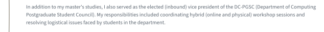</picture></a> 
    <a name="experience-1-utp-3-tile"><picture><source media="(max-width: 767px)" srcset="https://raw.githubusercontent.com/reeyan-afzal-khan/reeyan-afzal-khan/main/assets/drawings/documents/experience-1-utp-3-phone.svg"/></picture></a>
    <b>Graduate Research Assistant (GRA)</b> <a href="assets/documents/Reeyan-Afzal-Experience-Letter-UTP-GRA.jpeg"><picture><source media="(max-width: 767px)" srcset="https://raw.githubusercontent.com/reeyan-afzal-khan/reeyan-afzal-khan/main/assets/drawings/documents/blank.svg"/></picture></a>
    <a href="assets/documents/Reeyan-Afzal-Experience-Letter-UTP-GRA.jpeg"><picture><source media="(max-width: 767px)" srcset="https://raw.githubusercontent.com/reeyan-afzal-khan/reeyan-afzal-khan/main/assets/drawings/documents/tag-experience-letter.svg"/></picture></a> 
    <a name="experience-1-utp-3-about"><picture><source media="(max-width: 767px)" srcset="https://raw.githubusercontent.com/reeyan-afzal-khan/reeyan-afzal-khan/main/assets/drawings/documents/experience-1-utp-3-about-phone.svg"/><source media="(prefers-color-scheme: dark)" srcset="https://raw.githubusercontent.com/reeyan-afzal-khan/reeyan-afzal-khan/main/assets/drawings/documents/experience-1-utp-3-about-dark.svg"/></picture></a> 
     
    <a name="experience-2-nic-1-tile"><picture><source media="(max-width: 767px)" srcset="https://raw.githubusercontent.com/reeyan-afzal-khan/reeyan-afzal-khan/main/assets/drawings/documents/experience-2-nic-phone.svg"/></picture></a>
    <b>Founder and app developer, Hanzai</b> 
    NEP-NIC (PITB), Kohat <a href="assets/documents/Reeyan-Afzal-Experience-Letter-NEP-NIC.jpeg"><picture><source media="(max-width: 767px)" srcset="https://raw.githubusercontent.com/reeyan-afzal-khan/reeyan-afzal-khan/main/assets/drawings/documents/blank.svg"/></picture></a>
    <a href="assets/documents/Reeyan-Afzal-Experience-Letter-NEP-NIC.jpeg"><picture><source media="(max-width: 767px)" srcset="https://raw.githubusercontent.com/reeyan-afzal-khan/reeyan-afzal-khan/main/assets/drawings/documents/tag-experience-letter.svg"/></picture></a> 
    <a name="experience-2-nic-1-about"><picture><source media="(max-width: 767px)" srcset="https://raw.githubusercontent.com/reeyan-afzal-khan/reeyan-afzal-khan/main/assets/drawings/documents/experience-2-nic-1-about-phone.svg"/><source media="(prefers-color-scheme: dark)" srcset="https://raw.githubusercontent.com/reeyan-afzal-khan/reeyan-afzal-khan/main/assets/drawings/documents/experience-2-nic-1-about-dark.svg"/></picture></a> 

     
    <a name="education-1-utp-1-tile"><picture><source media="(max-width: 767px)" srcset="https://raw.githubusercontent.com/reeyan-afzal-khan/reeyan-afzal-khan/main/assets/drawings/documents/education-1-utp-phone.svg"/></picture></a>
    <b>Universiti Teknologi PETRONAS</b> 
    MSc Information Technology <a href="assets/documents/Reeyan-Afzal-MSc-Transcript.jpeg"><picture><source media="(max-width: 767px)" srcset="https://raw.githubusercontent.com/reeyan-afzal-khan/reeyan-afzal-khan/main/assets/drawings/documents/blank.svg"/></picture></a><a href="assets/documents/Reeyan-Afzal-MSc-Degree.jpeg"><picture><source media="(max-width: 767px)" srcset="https://raw.githubusercontent.com/reeyan-afzal-khan/reeyan-afzal-khan/main/assets/drawings/documents/blank.svg"/></picture></a>
    <a href="assets/documents/Reeyan-Afzal-MSc-Degree.jpeg"><picture><source media="(max-width: 767px)" srcset="https://raw.githubusercontent.com/reeyan-afzal-khan/reeyan-afzal-khan/main/assets/drawings/documents/tag-degree.svg"/></picture></a>
    <a href="assets/documents/Reeyan-Afzal-MSc-Transcript.jpeg"><picture><source media="(max-width: 767px)" srcset="https://raw.githubusercontent.com/reeyan-afzal-khan/reeyan-afzal-khan/main/assets/drawings/documents/tag-transcript.svg"/></picture></a> 
     
    <a name="education-2-kust-1-tile"><picture><source media="(max-width: 767px)" srcset="https://raw.githubusercontent.com/reeyan-afzal-khan/reeyan-afzal-khan/main/assets/drawings/documents/education-2-kust-phone.svg"/></picture></a>
    <b>Kohat University of Science and Technology</b> 
    BS Computer Science · CGPA 3.26 / 4.00 <a href="assets/documents/Reeyan-Afzal-BS-Transcript.jpeg"><picture><source media="(max-width: 767px)" srcset="https://raw.githubusercontent.com/reeyan-afzal-khan/reeyan-afzal-khan/main/assets/drawings/documents/blank.svg"/></picture></a><a href="assets/documents/Reeyan-Afzal-BS-Degree.jpeg"><picture><source media="(max-width: 767px)" srcset="https://raw.githubusercontent.com/reeyan-afzal-khan/reeyan-afzal-khan/main/assets/drawings/documents/blank.svg"/></picture></a>
    <a href="assets/documents/Reeyan-Afzal-BS-Degree.jpeg"><picture><source media="(max-width: 767px)" srcset="https://raw.githubusercontent.com/reeyan-afzal-khan/reeyan-afzal-khan/main/assets/drawings/documents/tag-degree.svg"/></picture></a>
    <a href="assets/documents/Reeyan-Afzal-BS-Transcript.jpeg"><picture><source media="(max-width: 767px)" srcset="https://raw.githubusercontent.com/reeyan-afzal-khan/reeyan-afzal-khan/main/assets/drawings/documents/tag-transcript.svg"/></picture></a> 

     
    <a name="language-1-ielts-1-tile"><picture><source media="(max-width: 767px)" srcset="https://raw.githubusercontent.com/reeyan-afzal-khan/reeyan-afzal-khan/main/assets/drawings/documents/language-1-ielts-phone.svg"/></picture></a>
    <b>IELTS Academic, band 7.0 (C1)</b> 
    English <a href="assets/documents/Reeyan-Afzal-Certificate-IELTS-2023.jpeg"><picture><source media="(max-width: 767px)" srcset="https://raw.githubusercontent.com/reeyan-afzal-khan/reeyan-afzal-khan/main/assets/drawings/documents/blank.svg"/></picture></a>
    <a href="assets/documents/Reeyan-Afzal-Certificate-IELTS-2023.jpeg"><picture><source media="(max-width: 767px)" srcset="https://raw.githubusercontent.com/reeyan-afzal-khan/reeyan-afzal-khan/main/assets/drawings/documents/tag-certificate.svg"/></picture></a> 
     
    <a name="language-2-hsk-1-tile"><picture><source media="(max-width: 767px)" srcset="https://raw.githubusercontent.com/reeyan-afzal-khan/reeyan-afzal-khan/main/assets/drawings/documents/language-2-hsk-phone.svg"/></picture></a>
    <b>HSK 4 and HSKK 2</b> 
    Chinese (Mandarin) <a href="assets/documents/Reeyan-Afzal-Certificate-HSK4-2024.jpeg"><picture><source media="(max-width: 767px)" srcset="https://raw.githubusercontent.com/reeyan-afzal-khan/reeyan-afzal-khan/main/assets/drawings/documents/blank.svg"/></picture></a>
    <a href="assets/documents/Reeyan-Afzal-Certificate-HSK4-2024.jpeg"><picture><source media="(max-width: 767px)" srcset="https://raw.githubusercontent.com/reeyan-afzal-khan/reeyan-afzal-khan/main/assets/drawings/documents/tag-certificate.svg"/></picture></a> 

<!-- ======================= SKILLS & TOOLS ======================= -->

  <a name="skills-programming-languages">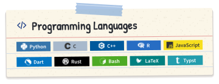</a>
  <a name="skills-ai-machine-learning">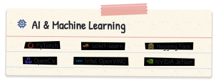</a>
  <a name="skills-data-science-analytics">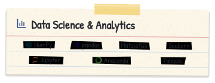</a>
  
  
  
  
  <a name="skills-operating-systems">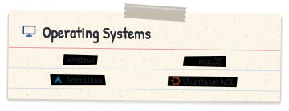</a>

